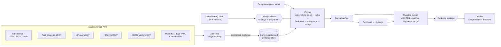

# controlmap

**SOC 2 evidence automation you can read end to end.** controlmap pulls evidence from the
exports a company already has (GitHub branch protection and CODEOWNERS, an AWS configuration
snapshot, an identity-provider user export, an HR roster, an MDM endpoint inventory, signed-off
procedural documents). It evaluates that evidence against a YAML control library mapped to the
SOC 2 Trust Services Criteria, with an ISO/IEC 27001:2022 Annex A crosswalk. It tracks
time-boxed exceptions, and builds a hashed, optionally signed evidence package that an auditor
can check with nothing but `shasum`.

> **controlmap supports an audit. It does not replace one.** It produces no audit opinion,
> no SOC 2 report and no attestation. Automated checks only test the evidence they are given,
> at one point in time. The service auditor decides whether evidence is sufficient, tests
> operating effectiveness across the examination period, and forms the opinion. The framework
> mappings in the sample library are this project's own judgement, not official AICPA or ISO
> mappings.

## Who it is for

- **Engineers at a startup preparing for a first SOC 2.** They need the evidence collection to
  be code they can review, rather than a black-box SaaS agent.
- **GRC and security teams** who want to rerun "are we still compliant?" checks
  in CI and hand auditors a package that cannot be quietly edited afterwards.
- **Reviewers of this portfolio project.** It shows how plugin architecture, deterministic
  hashing, point-in-time evaluation and tamper-evident packaging fit together in about 5k lines
  of typed Python.

## What it does

| Capability | How |
|---|---|
| Pluggable collectors | 6 built-in (`github`, `aws_snapshot`, `idp_csv`, `hris_csv`, `endpoint_csv`, `manual_documents`) plus a `controlmap.collectors` entry-point group for third-party ones. All of them read files or a mock API. |
| Evidence store | Content-addressed and append-only. Each record is canonical JSON named by its SHA-256, and attachments are hashed and copied. |
| Control library | YAML controls → rules + params, mapped to TSC criteria and Annex A. Everything is validated at load time against bundled catalogs (61 TSC criteria ids, 93 Annex A controls). |
| Rules | 22 built-in rules (MFA, leavers, dormant accounts, branch protection, CODEOWNERS, encryption, public buckets, admin ports, audit trails, KMS rotation, EDR, disk encryption, OS baseline, HR↔IdP↔MDM reconciliation, document recency, and others). Rules also load from the `controlmap.rules` entry-point group. |
| Freshness windows | Per library, per control or per rule. Evidence older than its window turns a passing rule `STALE`. |
| Point-in-time evaluation | `--as-of DATE` uses only evidence collected on or before that date, so past results can be reproduced. |
| Exceptions | Approved, time-boxed and matched by resource pattern. Expired or pending exceptions never apply, and matches that were blocked are reported. The register flags exceptions that are expiring soon, unused, or longer than the maximum duration. |
| Crosswalk | TSC ↔ Annex A, derived from the controls that test both, with honest coverage gaps. |
| Evidence package | Per-control Markdown + HTML, the evidence records relied on, `manifest.json` and `MANIFEST.sha256` (works with `shasum -c`), an optional Ed25519 signature, and a byte-reproducible `.tar.gz`. |
| Verification | `controlmap verify` checks hashes, unlisted files, symlinks, the checksum list, per-record digests, results→evidence references, the summary and the signature. It reports every problem it finds. |

## Architecture



Module map (`src/controlmap/`):

| Module | Responsibility |
|---|---|
| `collectors/` | Plugin base and registry, HTTP transport abstraction, the 6 built-in collectors, CODEOWNERS parser and matcher |
| `model.py`, `canonical.py`, `store.py` | Evidence model, canonical JSON and SHA-256, content-addressed store |
| `rules/` | Rule registry with typed parameters, 22 built-in rules grouped by domain |
| `frameworks.py`, `data/` | Bundled TSC and ISO 27001:2022 Annex A catalogs (identifiers and short labels) |
| `library.py` | Control library loader and validator |
| `exceptions.py` | Exception register: validation, lifecycle, matching, reporting |
| `engine.py` | Point-in-time evidence selection, the status decision table and roll-up |
| `crosswalk.py`, `render.py`, `templates/` | Derived crosswalk, Jinja2 Markdown and autoescaped HTML |
| `package/` | Builder, deterministic archive, Ed25519 signing, verifier |
| `project.py`, `cli.py` | `controlmap.yaml` config, collect/evaluate workflow, CLI |
| `mockapi.py` | Offline GitHub REST mock (in-process transport plus a loopback-only HTTP server) |

[docs/ARCHITECTURE.md](docs/ARCHITECTURE.md) covers the algorithms and their complexity,
[docs/COLLECTORS.md](docs/COLLECTORS.md) covers every input format, and
[docs/THREAT_MODEL.md](docs/THREAT_MODEL.md) covers what the package integrity does and does not protect against.

## Quickstart

Requires [uv](https://docs.astral.sh/uv/) (it installs Python 3.12 if needed).

```bash
make install            # uv sync --frozen
make check              # format + lint + mypy --strict + tests with coverage gate
make demo               # offline end-to-end run on the sample company

# or drive the CLI directly on the bundled sample company
cd examples/acme
uv run controlmap validate
uv run controlmap collect
uv run controlmap evaluate --details
uv run controlmap keygen --private ../../out/signing.pem --public ../../out/signing.pub
uv run controlmap package --out ../../out/pkg --archive ../../out/pkg.tar.gz --sign-key ../../out/signing.pem
uv run controlmap verify ../../out/pkg.tar.gz --public-key ../../out/signing.pub
```

Other commands: `crosswalk [--format md|csv|json]`, `exceptions [--as-of]`, `rules`,
`collectors`, `mock-github --fixture FILE`. `evaluate --fail-on FAIL,ERROR` exits 1 when a
control has one of those statuses, which makes it usable as a CI gate.

## The sample company

`examples/acme/` is a fictional company ("Acme Cloud, Inc."). Every file in it is
synthetic, and it is built to have **known passing and failing controls**.
`examples/acme/expected.yaml` records the expected status of each of its 22 controls and the
reason. `tests/test_acme_golden.py` asserts all of them, so any change to rule semantics shows up
as a failing test.

| Status | Controls | Example |
|---|---:|---|
| PASS | 11 | AC-02 (two human admins with MFA, root has MFA and no keys) |
| FAIL | 7 | AC-03 (a leaver terminated 2026-09-12 still has an active IdP account) |
| EXCEPTED | 2 | NW-01 (public marketing bucket under an approved, soon-expiring exception) |
| STALE | 1 | EP-01 (every disk is encrypted, but the inventory is 11 days old and the window is 7) |
| NO_EVIDENCE | 1 | BC-01 (backups pass, but no disaster-recovery test document exists) |

## Demo output

Pasted from a real `make demo` run (output trimmed where marked):

```text
$ controlmap -c acme/controlmap.yaml collect
COLLECTOR        TYPE              RECORDS  NEW  RESULT
github           github            6        6    ok
aws-prod         aws_snapshot      6        6    ok
okta             idp_csv           1        1    ok
workday          hris_csv          1        1    ok
jamf             endpoint_csv      1        1    ok
compliance-docs  manual_documents  6        6    ok
21 new evidence record(s) stored in acme/.controlmap/store

$ controlmap -c acme/controlmap.yaml evaluate --details
Acme Cloud, Inc. (fictional): 22 controls as of 2026-10-01

CONTROL  STATUS       TSC                TITLE
AC-01    FAIL         CC6.1              MFA for workforce identities
AC-02    PASS         CC6.1,CC6.3        Privileged access is limited and protected
AC-03    FAIL         CC6.2,CC6.3        Timely removal of leaver access
AC-04    EXCEPTED     CC6.2              Dormant accounts are disabled
...                                      (18 more rows)

AC-03 Timely removal of leaver access [FAIL]
  idp.leavers_deprovisioned: FAIL (tested 9)
    - eli@acme.example: terminated 2026-09-12 (19 days ago) but IdP account is still active [open]

EP-01 Laptop disk encryption [STALE]
  endpoint.disk_encryption: STALE (tested 7)
    note: endpoint.inventory for mdm:jamf is 11 days old (freshness window 7 days)

EP-04 Asset inventory reconciles with HR [FAIL]
  endpoint.inventory_reconciled: FAIL (tested 13)
    - device:D-1005: assigned to terminated employee eli@acme.example [open]

NW-02 Administrative ports are not internet-facing [FAIL]
  ! exception EXC-2025-007 matched findings but is not active on 2026-10-01
  cloud.admin_ports_restricted: FAIL (tested 3)
    - sg:sg-0bastion1: port 22 open to the internet [open]

PASS 11 | EXCEPTED 2 | STALE 1 | NO_EVIDENCE 1 | FAIL 7
Automated checks over collected evidence; this supports an audit, not replaces it.

$ controlmap -c acme/controlmap.yaml package --out out/acme-2026-10-01 --archive out/acme-2026-10-01.tar.gz --sign-key out/signing.pem --generated-at 2026-10-01T12:00:00Z
package written to out/acme-2026-10-01 (79 files)
manifest sha256: 58ec4e3ef170b20e3d88e5ec0b5e9b1577f42ae0e36380c03c10c5585da7b867
signed: yes

$ controlmap verify out/acme-2026-10-01.tar.gz --public-key out/signing.pub
files checked: 76, evidence records: 21
signature: valid, signer fingerprint c42671276721651d15a0630ef71a872429cbf1d1ecf0563ef0a0bc5a41c59abb
signer matches the trusted public key
VERIFIED

# Tampering: flip AC-01 from FAIL to PASS in the auditor-facing page
$ controlmap verify out/acme-2026-10-01
FAIL: content modified: controls/AC-01.md (sha256 e8021485081be9dd...)
NOT VERIFIED (1 problem(s))

# API mode: GitHub evidence pulled from the offline mock REST API on localhost
$ controlmap -c acme/controlmap.api.yaml evaluate --details      (filtered to CM-*)
CM-01 Peer-reviewed changes to production code [FAIL]
  github.branch_protection: FAIL (tested 3)
    - acme/sandbox@trunk: branch is not protected [open]
    - acme/web@main: administrators can bypass protection [open]
```

The signing key is generated fresh on every demo run, so the fingerprint and manifest digest
differ between runs. With the same key and `--generated-at`, two builds are byte-for-byte
identical (`tests/test_package.py::test_builds_are_byte_for_byte_reproducible`).

## Design decisions (summary)

The full list, with the cost of each one being wrong, is in [DECISIONS.md](DECISIONS.md).

- **The engine owns freshness and exceptions, and rules stay pure.** A rule only says what it
  tested and what deviates. Status precedence is fixed: `ERROR > NO_EVIDENCE (missing kind) >
  FAIL > NO_EVIDENCE (empty population) > STALE > EXCEPTED > PASS`. A known deviation outranks
  stale proof. A rule that tested zero items never reports PASS.
- **Evidence is content-addressed.** A record's digest covers kind, subject, source, collection
  time, normalized data and attachment hashes, but not the file path it came from. Re-collecting
  the same export is a no-op, and history accumulates naturally.
- **Collection time comes from the source, not from file mtimes.** The order is the config's
  `collected_at`, then a timestamp inside the export, then the clock. Mtimes change on copy.
- **The crosswalk is derived, not hand-maintained.** A TSC criterion and an Annex A control are
  linked only through a company control that is actually tested, so the crosswalk cannot drift
  from what is checked, and gaps are visible.
- **The package is verifiable without controlmap.** `MANIFEST.sha256` is plain `shasum -c`
  format. The Ed25519 signature over `manifest.json` covers every file. A key shipped inside
  the package proves integrity, not origin, so `--public-key` is how origin is checked.
- **Exceptions are explicit and expire.** They are matched by control, optional rule and
  resource glob. Excepted findings stay visible next to the approval, and an expired exception
  that would have matched is called out, not silently ignored.

## Benchmarks

Command: `make bench` (`scripts/bench.py`). It runs a seeded synthetic company with *N*
employees (one IdP account, HR row and laptop each), *N*/10 buckets and security groups, and
*N*/50 repositories, against the full 22-control library. Times are medians of 3 runs on an Apple
Silicon laptop (8 cores, 16 GB), single process, measured while other builds were running:

| employees | collect (s) | evaluate (s) | package (s) | verify (s) | evidence JSON |
|---:|---:|---:|---:|---:|---:|
| 100 | 0.030 | 0.066 | 0.062 | 0.021 | 77 KiB |
| 1,000 | 0.217 | 0.366 | 0.258 | 0.134 | 720 KiB |
| 10,000 | 2.035 | 3.228 | 2.244 | 1.355 | 7,222 KiB |

Every stage scales linearly. Evaluation re-reads and re-hashes every stored record (digests
are verified on load), which accounts for most of its cost. These are synthetic numbers that
show scaling. They do not predict any real company's runtime.

## Tests and coverage

| What | Command | Result (this commit) |
|---|---|---|
| Full gate | `make check` | ruff format + ruff lint (0 warnings) + `mypy --strict` + pytest |
| Tests | `uv run --frozen pytest` | 237 passed |
| Coverage | `make cov` (`--cov-fail-under=90`, branch coverage) | 97.55% of `controlmap` |

The suite includes at least one passing case and one failing case for every built-in rule,
property-based tests with Hypothesis (canonical JSON round-trips, CODEOWNERS glob semantics,
version-ordering antisymmetry, and evaluation that is independent of record order), and
golden end-to-end tests over the sample company. Package tests cover tampering: edited,
deleted, added and symlinked files, a rewritten manifest, a forged signature, a wrong trusted
key, evidence edited together with a consistently rewritten manifest, and unsafe archive members
(path traversal, links, multiple roots). API mode is tested over a real loopback HTTP socket
against the mock server.

## Limitations

- **Not an audit, and no live integrations.** Collectors read exports and snapshots. The
  GitHub collector can call a real REST API, but it has only been exercised against the bundled
  mock, never against live GitHub. There is no live AWS, Okta, Workday or Jamf integration.
  Producing the input files is the operator's job (see docs/COLLECTORS.md).
- **Garbage in, garbage out.** controlmap cannot tell whether an export is complete or genuine.
  Hashing proves a file was not changed after collection, not that it was true when collected.
  Timestamps are self-asserted, and there is no trusted timestamping.
- **The control library and mappings are illustrative.** The 22 Acme controls and their
  TSC and Annex A mappings are a plausible sample written for this project, not a complete
  SOC 2 control set. The crosswalk shows 23 of 38 in-scope criteria with an automated control.
  The rest (governance, board oversight, risk of fraud and others) need manual testing, and the
  package says so.
- **Point in time, not a period.** SOC 2 Type II tests operating effectiveness over a period.
  controlmap evaluates one date per run. Rerunning it on a schedule and keeping the packages is
  up to the operator. There is no built-in sampling or period roll-up.
- **Catalog text is abbreviated.** TSC labels are short paraphrases written for this project.
  Annex A entries carry only the control headings. The authoritative criteria and control text
  are in the AICPA and ISO publications.
- **Rule semantics are opinionated.** Examples: "dormant" is measured from the IdP's last-login
  date, a laptop counts as reporting by the MDM's `last_checkin`, and Linux OS baselines are
  compared on the distribution version string. The parameters cover common variations but not
  every policy.
- **Single-user tool.** The store is a local directory with no locking for concurrent writers
  (writes are atomic renames, so a crash cannot leave a half-written record).
- **CI has not run.** `.github/workflows/ci.yml` mirrors `make check` and `make demo`, but the
  repository has not been pushed, so the workflow has never executed on GitHub.

## Roadmap

- Period evaluation: run `--as-of` across a range, roll up per-control operating history, and
  draw samples for Type II-style testing.
- Authenticated collectors for live APIs (Okta, Google Workspace, AWS through read-only
  credentials) behind the same `Transport` abstraction, tested against recorded fixtures.
- RFC 3161 trusted timestamps on the manifest signature.
- A `diff` command that compares two packages (what changed between evaluations).
- Policy-as-data rule packs (for example CIS AWS Foundations) as an installable plugin.

## License

MIT, see [LICENSE](LICENSE).
